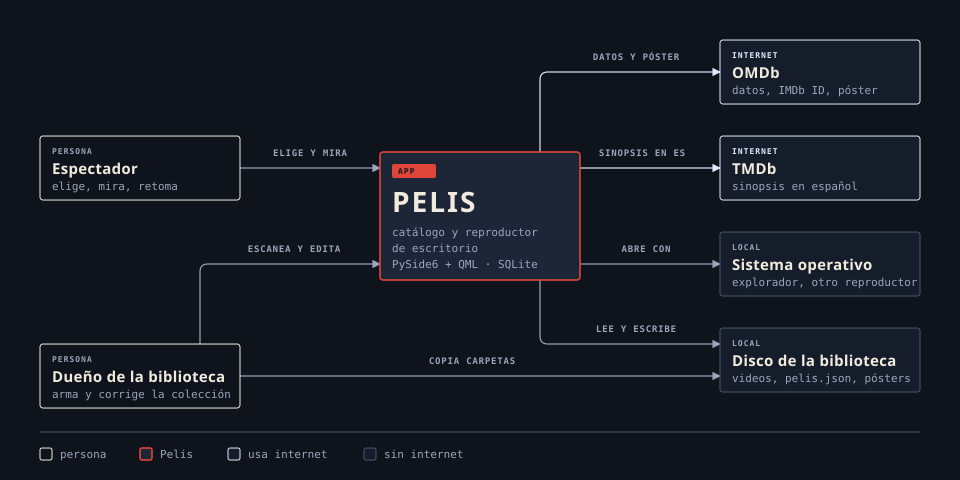

<div align="center">

# Pelis

*Catálogo y reproductor de escritorio para tu propia colección de películas.*


[Features](#features) • [Instalación](#instalación) • [Uso](#uso) • [Cómo funciona](#cómo-funciona) • [Configuración](#configuración) • [Desarrollo](#desarrollo)

</div>

Pelis recorre una carpeta con una subcarpeta por película, busca los datos en OMDb (y la sinopsis en español en TMDb) y arma una grilla de pósters. Desde ahí abrís el detalle y la mirás en el reproductor propio, que guarda dónde quedaste. Sin servidor ni cuentas: la biblioteca, la base y los metadatos viven en el disco, y todo menos la búsqueda de datos y pósters funciona sin internet.

Está pensada para un disco compartido (NTFS) que se monta tanto en Windows como en Linux Mint con una sola base, aunque también anda instalada en una sola PC.

## Features

- **Catálogo** en grilla de pósters: las que están a medias primero, con su barra de progreso, y las vistas al final. Filtros Todas / Sin ver / Vistas, por época (décadas y los últimos 4 años) y por datos o póster faltantes.
- **Buscador** por título, director y reparto, sin distinguir mayúsculas ni acentos.
- **Recomendación del día**: al abrir, una película al azar que no viste ni empezaste.
- **Detalle** con sinopsis, año, género, país, dirección y elenco, y a qué hora termina si la empezás ahora. Reproducir, continuar, marcar como vista, abrir la carpeta o abrir con el reproductor del sistema.
- **Personas**: un director o actor que está en otra película de la biblioteca se puede tocar y muestra todas sus películas.
- **Reproductor propio** sobre QtMultimedia: seek, pista de audio, subtítulos externos (`.srt`/`.ass`/`.vtt`, UTF-8 o Windows-1252) y embebidos, pantalla completa y controles que se ocultan solos. Audio y subtítulos se eligen solos según el idioma preferido; el tamaño y el color de los subtítulos externos se recuerdan para todas las películas.
- **Capturas**: la tecla `.` guarda el cuadro actual en `capturas/` dentro de la carpeta de la película, y el detalle las muestra en una grilla.
- **Progreso guardado** al pausar, salir y cerrar; retoma exactamente donde quedó.
- **Editar datos**: traer los de IMDb buscando por título o pegando el ID o el link (corrige un match equivocado o completa una "no encontrada"), volver a traerlos, o cargarlos a mano.
- **Pósters propios con rotación**: la app usa las imágenes de la carpeta y, cada 7 días, cambia al azar entre ellas. También se renuevan a mano desde el catálogo.
- **Faltantes**: una carpeta renombrada se reconoce sola por su IMDb ID y conserva progreso y vista; si no tiene ID, se le asigna su carpeta nueva a mano.
- **Metadatos portables**: cada película guarda un `pelis.json` en su carpeta, así una base nueva se reconstruye sin volver a consultar OMDb.

## Instalación

### Requisitos

- [uv](https://docs.astral.sh/uv/getting-started/installation/), que trae Python 3.12 si no lo tenés e instala las dependencias exactas de `uv.lock`
- Una clave de [OMDb](https://www.omdbapi.com/apikey.aspx) para los datos y pósters (opcional, sin ella no busca nada)
- Una clave de [TMDb](https://www.themoviedb.org/settings/api) para la sinopsis en español (opcional)

> [!IMPORTANT]
> En Linux hace falta `libxcb-cursor0`: sin él la app no abre ventana. El set-up completo está en [`LINUX.md`](LINUX.md).

### Correr desde el código

Creá `dev/pelis.toml` a partir de [`tools/pelis.toml.ejemplo`](tools/pelis.toml.ejemplo) y apuntá `biblioteca` a tu carpeta de películas. Después corré `dev.bat` (Windows) o `./dev.sh` (Linux).

Los dos son un atajo para `uv run python -m pelis --app-dir dev`: la primera vez arman el entorno (`.venv` en Windows, `.venv-linux` en Linux, así no se pisan en un disco compartido) y después instalan solo lo que cambie en `uv.lock`. La carpeta de `--app-dir` es donde viven `pelis.toml`, la base `pelis.db` y `preferencias.ini`.

### Armar el ejecutable

```bat
tools\build_win.bat
```

Genera `dist\Pelis-win\` con PyInstaller, listo para copiar a la raíz del disco:

```
D:\
├── Peliculas\          biblioteca, una carpeta por película
├── pelis-app\
│   └── app\
│       ├── win\        pelis.exe + _internal\
│       ├── pelis.db    se crea sola al primer arranque
│       └── pelis.toml  copiado de pelis.toml.ejemplo
└── Pelis.bat           lanzador
```

Qt y FFmpeg van dentro del build, no hace falta instalar nada más. El build de Linux (`tools/build_linux.sh`, lanzador `pelis.sh`) está en [`LINUX.md`](LINUX.md#armar-el-ejecutable).

## Uso

### La biblioteca

Cada película es una subcarpeta directa de la biblioteca, con exactamente un video:

```
Peliculas\
└── Babel (2006)\
    ├── Babel 2006 (1080p x265 10bit Tigole).mkv
    ├── opensubtitles.srt
    ├── posters\
    │   └── poster.jpg
    ├── capturas\
    │   └── 01-12-34.png
    └── pelis.json
```

- **El nombre de la carpeta es el título** que se muestra, siempre. El año puede ir al final `Alien (1979)` o al principio `(1979) Alien`.
- **Pósters**: imágenes `.jpg`, `.jpeg` o `.png` dentro de `posters/`, o sueltas con `poster`, `folder` o `cover` en el nombre (en ese orden de preferencia). Si no hay ninguna, se baja la de OMDb a `posters/poster.jpg`. Una imagen agregada después reemplaza a la de OMDb al abrir el detalle o la app. Para sacar una de la rotación, borrala.
- **Subtítulos externos**: sueltos al lado del video, nunca en subcarpetas. Se buscan al abrir el reproductor, así que no hace falta re-escanear.
- **Forzar el match**: si OMDb no la encuentra por título, poné el IMDb ID en el nombre de la carpeta, `Alien (1979) [tt0078748]`, o creá un `pelis.json` con solo `{"imdb_id": "tt0078748"}`, y volvé a escanear.
- **Copiar películas entre bibliotecas**: copiá la carpeta entera y abrí la app. Si trae su `pelis.json`, entra con todos los datos y el póster; si no, aparece con el título de la carpeta hasta el próximo escaneo. Lo visto y el progreso no viajan: viven en la base.

> [!IMPORTANT]
> Una carpeta sin video o con más de uno no se importa y aparece en el informe del escaneo como "carpeta con problemas".

### Al abrir la app y al escanear

Al abrir, la app suma sola las carpetas nuevas, sin internet. Las que no traen `pelis.json` quedan pendientes: **«…» › Escanear biblioteca** les busca los datos en OMDb y TMDb y muestra un informe al terminar.

| | Al abrir la app | Escanear biblioteca |
|---|---|---|
| Carpetas nuevas con `pelis.json` completo | Se suman con sus datos | Se suman con sus datos |
| Carpetas nuevas sin `pelis.json` | Se suman como pendientes | Busca en OMDb y TMDb y escribe el `pelis.json` |
| Pendientes de datos | Siguen pendientes | Busca en OMDb y TMDb |
| Carpetas que ya no están | No se tocan | Se marcan faltantes y se ocultan |
| Faltantes que volvieron | Se reactivan | Se reactivan |
| Carpetas renombradas (mismo IMDb ID) | Toman el registro viejo | Toman el registro viejo |
| Usa internet | No | Sí |

### Atajos de teclado

| Dónde | Tecla | Acción |
|---|---|---|
| Catálogo | `Ctrl+F` o `/` | Ir al buscador |
| Catálogo | `Esc` | Limpiar la búsqueda |
| Detalle | `Esc` | Volver al catálogo |
| Editar datos | `Ctrl+S` | Guardar |
| Editar datos, Faltantes | `Esc` | Volver |
| Reproductor | `Espacio` | Play / pausa |
| Reproductor | `←` / `→` | −10 s / +10 s |
| Reproductor | `Ctrl+←` / `Ctrl+→` | −1 min / +1 min |
| Reproductor | `↑` / `↓` | Subir / bajar volumen |
| Reproductor | `M` | Silenciar |
| Reproductor | `F` o doble click | Pantalla completa |
| Reproductor | `.` | Guardar una captura |
| Reproductor | `Esc` | Salir de pantalla completa, o volver al detalle |

## Cómo funciona



Pelis es una sola app de escritorio. Quien la usa para mirar elige, reproduce y retoma; quien arma la colección copia carpetas al disco, escanea y corrige datos. Todo lo de cada película (video, subtítulos, pósters, capturas, `pelis.json`) vive en su carpeta del disco, y lo de cada biblioteca (progreso, vistas, qué póster toca) en la base SQLite de la carpeta app. Internet solo se usa al escanear o al editar datos: OMDb para los datos, el IMDb ID y el póster, TMDb para la sinopsis en español. El sistema operativo abre la carpeta de la película o el video en otro reproductor.

Los casos de uso completos, con sus reglas, están en [`docs/casos-de-uso.md`](docs/casos-de-uso.md).

## Configuración

`pelis.toml` vive en la carpeta app:

```toml
biblioteca       = "../../Peliculas"   # relativa a la carpeta de pelis.toml, o absoluta
omdb_api_key     = ""                  # vacío = no busca metadatos
tmdb_api_key     = ""                  # vacío = sinopsis de OMDb en inglés
idiomas_sinopsis = ["es-MX", "es-ES"]  # orden en que se prueban en TMDb
audio_preferido  = "es"
subs_preferido   = "es"
```

> [!TIP]
> Con una ruta relativa, el mismo disco funciona con cualquier letra de unidad o punto de montaje. En la base, las rutas de las películas se guardan relativas a `biblioteca`.

## Desarrollo

```
src/pelis/
├── __main__.py           arranque (python -m pelis)
├── config.py             pelis.toml y rutas
├── db.py                 SQLite, SQL a mano
├── escaneo.py            escaneo de la biblioteca, importación al abrir e informe
├── nombres.py            título, año, IMDb ID e idioma desde nombres de carpetas y archivos
├── metadatos.py          único que guarda metadatos en la base y escribe pelis.json
├── archivo_metadatos.py  lectura y escritura de pelis.json
├── edicion.py            edición a mano, corrección del match y faltantes
├── poster.py             set de pósters, el actual y la rotación
├── catalogo.py           épocas, tarjetas, incompletas y la recomendada
├── capturas.py           guardar y listar capturas
├── omdb.py, tmdb.py      clientes de metadatos
├── subtitulos.py         subtítulos externos y elección de pistas
├── puente.py             expone modelos y slots a QML
└── qml/                  interfaz (catálogo, detalle, edición, reproductor)
```

Los módulos de lógica no importan Qt, así que se testean sin UI:

```bash
set UV_PROJECT_ENVIRONMENT=.venv && uv run pytest              # Windows (cmd)
UV_PROJECT_ENVIRONMENT=.venv-linux uv run pytest              # Linux
```

Para sumar o actualizar una dependencia, `uv add <paquete>` o `uv lock --upgrade-package <paquete>`, y commiteá `uv.lock` junto con `pyproject.toml`.

Las reglas del escaneo están en la [spec de la biblioteca](.scratch/biblioteca-multimedia/spec.md), el vocabulario en [`GLOSSARY.md`](GLOSSARY.md), las decisiones en [`docs/adr/`](docs/adr/) y las de producto y diseño visual en [`PRODUCT.md`](PRODUCT.md) y [`DESIGN.md`](DESIGN.md).
